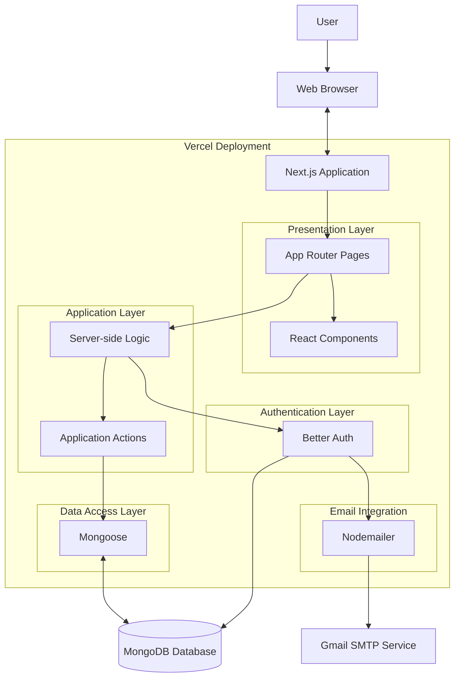
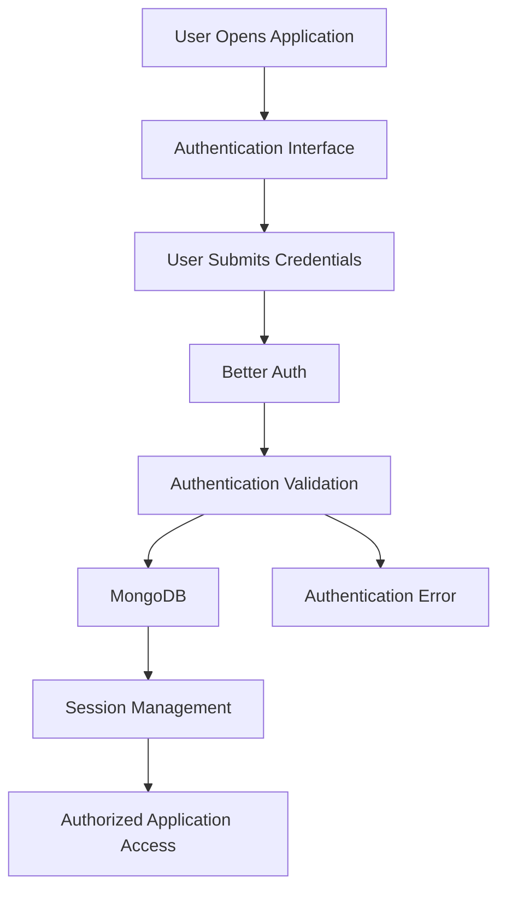
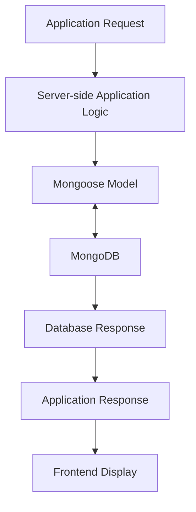

# System Architecture

### 1. Introduction

Signalist follows a full-stack web application architecture built using Next.js and its App Router.

The architecture integrates frontend rendering, server-side application logic, authentication, database operations, and email functionality within a unified application.

MongoDB provides persistent data storage, while Mongoose manages database models and interactions. Better Auth handles user authentication, and Nodemailer supports email delivery.

The application is deployed using Vercel.

### 2. Architecture Overview

Signalist follows a modular architecture consisting of the following layers:

1. Presentation Layer
2. Application Logic Layer
3. Authentication Layer
4. Data Access Layer
5. Database Layer
6. Email Integration Layer
7. Deployment Layer

Each layer has a specific responsibility within the application.

### 3. System Architecture Diagram

The following diagram illustrates the high-level architecture of Signalist.

### 4. Architectural Components

#### 4.1 Presentation Layer

The presentation layer is responsible for displaying the application interface and handling user interactions.

**Technologies:**

* Next.js
* React.js
* TypeScript
* Tailwind CSS

**Responsibilities:**

* Render application pages.
* Display stock-related information.
* Handle user interactions.
* Manage application navigation.
* Provide responsive layouts.
* Display authentication interfaces.

#### 4.2 Application Logic Layer

The application logic layer handles the processing of application requests.

**Responsibilities:**

* Process user interactions.
* Execute application actions.
* Coordinate data operations.
* Handle server-side functionality.
* Connect application modules.

The application uses Next.js server-side functionality rather than requiring a separate Express.js backend.

#### 4.3 Authentication Layer

Better Auth is integrated to manage user authentication.

**Responsibilities:**

* Handle user registration.
* Manage user login.
* Maintain authentication sessions.
* Handle authentication-related requests.
* Support protected application access.

Authentication requests are handled through the application's authentication integration.

#### 4.4 Data Access Layer

Mongoose provides the connection between application logic and MongoDB.

**Responsibilities:**

* Define database schemas.
* Manage data models.
* Perform database queries.
* Create and retrieve records.
* Update and delete stored information.

Mongoose helps maintain structured database interactions.

#### 4.5 Database Layer

MongoDB is used as the application's NoSQL database.

**Responsibilities:**

* Store application data.
* Maintain user-related records.
* Support database queries.
* Persist application information.
* Support structured data retrieval through Mongoose models.

#### 4.6 Email Integration Layer

Nodemailer is used to support email delivery through the configured Gmail SMTP service.

**Responsibilities:**

* Configure email transport.
* Send application-related emails.
* Integrate email functionality with application workflows.

#### 4.7 Deployment Layer

Vercel is used to host the Signalist application.

**Responsibilities:**

* Host the Next.js application.
* Build and deploy application code.
* Provide public application access.
* Support GitHub-based deployment workflows.

### 5. Application Request Flow

The general request flow is described below.

#### Step 1: User Interaction

The user accesses Signalist through a web browser.

#### Step 2: Frontend Rendering

Next.js processes the application route and renders the appropriate interface using React components.

#### Step 3: Application Processing

Application logic handles the requested operation and determines whether authentication or database access is required.

#### Step 4: Authentication

Better Auth handles authentication-related operations and session management.

#### Step 5: Database Interaction

Mongoose communicates with MongoDB to perform the required database operations.

#### Step 6: Response Processing

The application processes the returned information and prepares the appropriate response.

#### Step 7: User Interface Update

The frontend displays the resulting information to the user.

### 6. Authentication Workflow

The authentication workflow is integrated using Better Auth.

### 7. Database Communication Workflow

The database communication process follows this structure:

### 8. Architecture Design Principles

#### Modularity

The application separates different responsibilities into organized modules.

#### Reusability

Reusable React components help reduce duplicated interface code.

#### Maintainability

TypeScript and structured application modules support easier maintenance.

#### Separation of Responsibilities

Authentication, database access, presentation, and email functionality are organized into distinct areas.

#### Scalability

The modular full-stack architecture provides a foundation for future enhancements.

### 9. Deployment Architecture

The application is deployed using Vercel.

The deployment workflow is:

1. Source code is maintained in GitHub.
2. Changes are pushed to the repository.
3. Vercel builds the Next.js application through the configured deployment integration.
4. The application is deployed to the hosting environment.
5. Users access the deployed application through its public URL.

### 10. Architecture Summary

| Component         | Technology     | Responsibility          |
| ----------------- | -------------- | ----------------------- |
| Frontend          | Next.js, React | User interface          |
| Language          | TypeScript     | Application development |
| Styling           | Tailwind CSS   | UI design               |
| Application Logic | Next.js        | Server-side processing  |
| Authentication    | Better Auth    | User authentication     |
| ODM               | Mongoose       | Database interaction    |
| Database          | MongoDB        | Persistent storage      |
| Email             | Nodemailer     | Email delivery          |
| SMTP              | Gmail SMTP     | Email transport         |
| Hosting           | Vercel         | Application deployment  |
| Version Control   | GitHub         | Source code management  |

### 11. Conclusion

Signalist uses a modular full-stack architecture built around Next.js, MongoDB, Mongoose, and Better Auth.

The architecture integrates presentation, application processing, authentication, database management, and email delivery within a unified application.

This design provides a maintainable foundation for developing and extending the Signalist stock market tracking platform.

***

**End of System Architecture**
